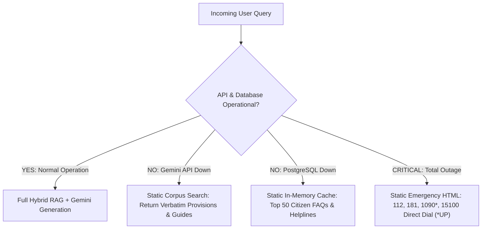

# NYAYASETU — SECURITY, PRIVACY, & SAFETY THREAT ASSESSMENT (REVISED)
**Document Identifier:** `docs/planning/06_SECURITY_PRIVACY_SAFETY.md`  
**Project:** NyayaSetu (AI-Assisted Pre-Litigation Legal Information & Triage Platform)  
**Author / Lead Security Reviewer:** Principal Security Architect & Legal-Tech Compliance Officer  
**Status:** AUDITED ASSESSMENT & RISK MATRIX — REVISED VERSION  
**Revision Date:** October 28, 2026 (Local Time: 05:52 IST)  

---

## 1. Executive Security & Privacy Mandate

In legal-civic technology, technical vulnerabilities directly impact human safety, liberty, and rights. A data leak can expose a domestic abuse survivor's location; an inaccurate legal citation can cause a citizen to forfeit statutory limitation deadlines; a fabricated emergency hotline can delay life-saving police intervention.

NyayaSetu adheres to the **Principle of Defensive Engineering**:
1. Zero storage of sensitive personal data by default (Data Minimization).
2. Complete segregation between emergency safety logic and external LLM inference.
3. Strict treatment of all retrieved text, database entries, and user inputs as untrusted data.
4. Total honesty regarding technical guarantees: no claiming "100% untraceable" without verifying server logs, reverse proxies, and browser caches.

---

## 2. Threat Modeling (STRIDE Analysis for Legal RAG)

| STRIDE Threat Category | Specific Legal-Tech Attack Vector | Severity | Targeted Component |
| :--- | :--- | :--- | :--- |
| **Spoofing Identity** | Attacker impersonating an advocate, court official, or emergency authority; session hijacking. | High | Case Tracker & Auth Layer |
| **Tampering with Data** | Prompt injection in retrieved documents attempting to alter legal definitions or emergency numbers; SQL injection in statute search. | Critical | Retrieval Pipeline & Vector Store |
| **Repudiation** | Dispute over legal information provided; user claiming system guaranteed a court outcome. | High | Grounded Legal Assistant & Disclaimers |
| **Information Disclosure** | Accidental persistence or logging of survivor narratives, domestic abuse details, or banking fraud data in application server logs. | Critical | Triage Orchestrator & Logging Engine |
| **Denial of Service** | Resource exhaustion attacks via long queries or embedding flood; exhausting Gemini API rate limits. | High | API Gateway & ML Classifier |
| **Elevation of Privilege** | Cross-tenant user case leakage via misconfigured database Row-Level Security (RLS). | Critical | User Cases Table & Supabase RLS |

---

## 3. Comprehensive Risk Matrix: Prevention, Detection, Fallback & Testing

| # | Major Risk Description | Preventive Control (Design Defense) | Detection Mechanism | Fallback Behavior | Verification & Test Procedure |
| :--- | :--- | :--- | :--- | :--- | :--- |
| **1** | **Missed Emergency in Personal Safety / Abuse** | Dual-gate deterministic regex filter executes *before* statistical classifier. Asymmetric cost weighting penalizes missed emergencies 100x over false alarms. Persistent prominent emergency button on all pages. | Continuous monitoring of Emergency False Negative Rate (FNR) on benchmark suites. | If classifier is uncertain, system automatically defaults to displaying the Emergency Safety Banner. | Automated test suite with 300+ urgent/non-urgent boundary prompts. **Target: FNR < 0.5% [Proposed Target]**. *(Note: Acknowledged that zero missed emergencies cannot be theoretically guaranteed by an automated model).* |
| **2** | **Citation Spoofing & Fabricated Sections** | Evidence Gate verifies every generated citation tag against actual primary provision IDs stored in PostgreSQL. Retrieving primary law grounds text, but does not eliminate hallucinations. | Regex parsing of citations in LLM output cross-referenced with DB primary keys. | If an unverified section is cited, strip the citation and fall back to displaying verbatim retrieved text. | Golden test set with adversarial queries asking for non-existent sections (e.g. "Section 498B of IPC"). System must abstain. |
| **3** | **Stale / Repealed Criminal Law (IPC vs BNS Nuance)** | Enforced incident date check. Factors in Section 358 BNS and Section 531 BNSS savings clauses (prior offences and ongoing proceedings continue under IPC/CrPC). | Automated date parser in query pre-processor. | If date is ambiguous, system presents BNS 2023 with an explicit historical IPC transition note and savings clause explanation. | Regression test on criminal queries verifying BNS 2023 citations for modern events and IPC citations for pre-July 2024 events. |
| **4** | **Prompt Injection via Retrieved Context** | Retrieved legal texts are injected strictly inside delimited, tagged XML context blocks (`<legal_context>`). Prompt enforces that legal context is passive reference data. | Pre-indexing scan of legal corpus for injection patterns (`"Ignore previous instructions"`). | If injection text is detected in user query, string is escaped and treated as literal plain text. | Adversarial prompt injection benchmark (BIAS / In-The-Wild injection payloads). |
| **5** | **Limits of Anonymous Mode & PII Leakage** | Anonymous Mode sets zero tracking cookies, writes zero rows to PostgreSQL, and uses client-side `sessionStorage`. Server logging middleware masks IP addresses and query strings. | Static code analysis verifying that no `INSERT INTO triage_sessions` executes during anonymous sessions. | Ephemeral in-memory execution only. | Audit server log outputs (`journalctl` / docker logs) to ensure no plaintext queries or IPs are written. UI truthfully explains network-level logging limits. |
| **6** | **Cross-User Case Exposure** | PostgreSQL Row-Level Security (RLS) enabled on `user_cases`. Queries strictly enforce `WHERE auth.uid() = user_id`. | Automated Supabase RLS policy audit scripts. | DB query returns empty set if user ID is missing or unauthorized. | Multi-tenant penetration test: User A attempts to read User B's case record by UUID. Expect HTTP 403 / empty result. |
| **7** | **Unreasonable Impression of Legal Advice** | Clear constitutional disclaimers on every page. Mandatory 5-part response structure distinguishing general rights from case-specific legal strategy. NALSA wizard marked as preliminary guidance only. | Output validation scanner checks for forbidden phrases (*"You will win"*, *"I advise you to"*, *"File suit immediately"*). | Automatic rewriting to neutral educational language: *"Under Section X, courts consider factors A and B."* | LLM-as-judge compliance audit on 100 generated answers to verify zero advisory overreach. |
| **8** | **Fabrication of Lawyer Profiles & Ratings** | **Complete prohibition of private lawyer directories in MVP.** Only official government authorities (NALSA, SLSAs, DLSAs) are listed. | Directory validation script ensures all listed entities match the official Ministry of Law & Justice gazette. | Display only the 15100 national helpline and DLSA physical office locator. | Review directory database to ensure zero individual private lawyer listings exist. |
| **9** | **Unverified / Geographically Mismatched Helplines** | Emergency numbers are hardcoded constants audited against official Ministry directives (112 universal, 181 across 35 States/UTs, 1930 cyber, 15100 NALSA, 1090 UP-specific). Never generated by LLM. | Static verification against official government telecom portals. | Static fallback HTML table if dynamic routing engine crashes. | Automated telephone directory integration test verifying official portal links. |
| **10**| **API Denial of Service & Abuse** | Strict IP and session-based rate limiting via Token Bucket algorithm (e.g. max 15 requests per minute per IP for triage). | Real-time rate limit violation alerting. | Returns HTTP 429 (Too Many Requests) with retry-after header and static emergency helpline banner. | Load testing script simulating 50 concurrent requests per second. |

---

## 4. Truthful Privacy Architecture & Limits of Anonymity

Many public platforms claim to be "100% anonymous" while quietly collecting analytics, logging IPs, or storing database records. NyayaSetu enforces a **Verified, Honest Privacy Architecture**:

```
┌────────────────────────────────────────────────────────────────────────┐
│                        TRUTHFUL PRIVACY AUDIT                          │
├───────────────────┬────────────────────────────────────────────────────┤
│ Client Storage    │ Uses exclusively `sessionStorage` (purged on tab  │
│                   │ close). Zero `localStorage`, zero tracking cookies.│
├───────────────────┼────────────────────────────────────────────────────┤
│ Database Writes   │ ZERO database writes to PostgreSQL during anonymous│
│                   │ triage sessions. Queries run purely in-memory.     │
├───────────────────┼────────────────────────────────────────────────────┤
│ Application Logs  │ Server application logger masks IP and query text: │
│                   │ `logger.info(mask_pii(request.path, request.ip))`  │
├───────────────────┼────────────────────────────────────────────────────┤
│ Third-Party Track │ ZERO third-party analytics scripts (No Google      │
│                   │ Analytics, no Facebook Pixel, no Hotjar).          │
├───────────────────┼────────────────────────────────────────────────────┤
│ REALISTIC LIMITS  │ The interface explicitly informs citizens:         │
│ (What We CANNOT   │ 1. Network reverse proxies (Cloudflare/Vercel) may │
│  Guarantee)       │    log connection IP/timestamp metadata.           │
│                   │ 2. Local Wi-Fi router / ISP logs DNS queries.      │
│                   │ 3. Device keyloggers or stalkerware installed on   │
│                   │    the citizen's device can observe screen input.  │
│                   │ 4. Quick-Exit replaces browser history, but cannot │
│                   │    erase ISP records or physical browser spyware.  │
└───────────────────┴────────────────────────────────────────────────────┘
```

---

## 5. Safe Failure & Graceful Degradation Protocols

NyayaSetu is designed to survive partial system failures without abandoning the user:


